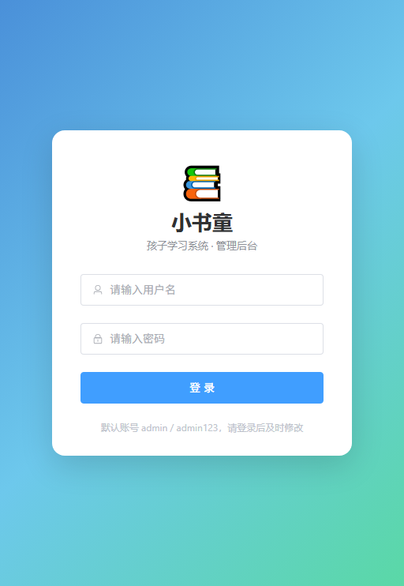

# 小书童 · 孩子学习系统

一套面向家庭的**自托管儿童学习资源管理与播放系统**：后台统一搜索、转存、编目网盘资源，孩子端用图标化大按钮浏览、听音频、看视频和绘本 PDF，并由 AI 结合孩子年级给出学习建议。

> 当前版本：**v1.8.0**（服务端唯一真源 = `backend/internal/version/version.go` 的 `Version`，
> 升版本只改那一行。后台「系统状态」与 `GET /api/health` 显示的就是它。
> 安卓客户端各自计数：标配 APK 见 `android/app/build.gradle`，PRO 见 `edge-client/android/app/build.gradle`）
> 技术栈：Go 1.22 + Gin + GORM + PostgreSQL ｜ Vue 3 + Vite ｜ Element Plus（后台）/ Vant（孩子端）｜ Docker Compose
> 三种客户端形态：管理后台 · 孩子端 PWA · 安卓 APK

---

## 目录

- [核心能力](#核心能力)
- [架构总览](#架构总览)
- [快速开始](#快速开始)
- [目录结构](#目录结构)
- [网盘 Cookie 配置](#网盘-cookie-配置)
- [非会员加速原理](#非会员加速原理)
- [视频转码（HLS）](#视频转码hls)
- [资源存活巡检](#资源存活巡检)
- [接口一览](#接口一览)
- [常见问题](#常见问题)
- [离线一致性校验](#离线一致性校验)
- [验证状态](#验证状态)
- [交付路线图](#交付路线图)

---

## 核心能力

### 后台管理端

| 模块 | 说明 |
| --- | --- |
| 资源搜索 | 对接 [PanSou](https://github.com/fish2018/pansou) 聚合搜索各大网盘，支持多插件源并发；内置 `/api/check/links` 链接存活检测 |
| 存活侦测 | 接入 [PanCheck](https://github.com/Lampon/PanCheck) 做定时批量检测，自动标记失效资源 |
| 资源巡检 | 定时全库扫描，PanSou → PanCheck 双引擎降级；连续失败才判死，避免误标 |
| 一键转存 | 解析分享链接 → 保存到指定网盘账号的指定目录 → 自动生成资源记录 |
| 网盘配置 | 扫码登录 + 手动 Cookie 双通道，支持**夸克 / 百度 / UC / 天翼**四家（另含阿里云盘适配器） |
| 目录管理 | 多级树状目录，可自由增删改层级（如 乐学英语 → 新概念英语 → 第一册） |
| 用户管理 | 新建用户、设定权限有效期、按目录粒度授权；授权父目录自动覆盖全部子目录 |
| 视频转码 | ffmpeg → HLS 多档位（360/480/720p），按需转码 + 并发闸门 + 任务取消 + 产物预览 |
| 缓存管理 | 转码产物 TTL + LRU 双闸淘汰，定时清理；回收后自动重转，资源不丢失 |
| 后台播放 | 网页端直接播放音频/视频/PDF，支持断点续播 |
| AI 配置 | 任意 OpenAI 兼容接口（OpenAI / DeepSeek / 通义千问 / Ollama），API Key 加密存储 |
| 学情分析 | 记录学习时长与进度，调用 AI 生成阶段性学习报告 |

### 孩子端（PWA + 安卓套壳）

| 模块 | 说明 |
| --- | --- |
| 图标化导航 | 一级图标（乐学英语）→ 二级（新概念英语）→ 资源，用孩子喜欢的 emoji 做图标并配彩色底 |
| 顶部大搜索 | 圆角胶囊搜索框，带热词引导 |
| AI 智能体 | 「小书童」对话页，结合孩子年级 + 站内实际资源给出学习建议，推荐结果可直接点开播放 |
| 音频播放 | 封面律动、倍速（0.75/1/1.25/1.5）、单曲循环、±15 秒、断点续播 |
| 视频播放 | 原生控件 + `MediaSession`，**支持息屏与后台播放**，自动连播下一集 |
| 绘本阅读 | PDF blob 内嵌阅读 + 新窗口打开兜底 |
| PWA | 可添加到主屏幕、Service Worker 预缓存、快捷入口（找一找 / 问小书童） |
| 学习记录 | 「我的」页展示今日/本周学习时长、最近听过、学习记录 |
| 安卓 APK | WebView 套壳，前台服务 + 唤醒锁保障息屏播放，接管返回键与全屏视频 |

---

## 架构总览

```
                      ┌──────────────────────────────────────┐
   孩子端 PWA  ──────▶│  Nginx (frontend-kid :8091)          │
   管理后台    ──────▶│  Nginx (frontend   :8090)            │
                      │  · 静态资源  · /api 反代  · /media 流 │
                      └───────────────┬──────────────────────┘
                                      │
                      ┌───────────────▼──────────────────────┐
                      │  Go 核心服务 (core-server :8080)      │
                      │  ┌────────────────────────────────┐  │
                      │  │ Router · Middleware (JWT/CORS) │  │
                      │  ├────────────────────────────────┤  │
                      │  │ Handler 层（10 个模块）          │  │
                      │  ├────────────────────────────────┤  │
                      │  │ Service 层                      │  │
                      │  │  · PermissionService（目录授权）  │  │
                      │  │  · PansouClient（搜索/存活）      │  │
                      │  ├────────────────────────────────┤  │
                      │  │ Adapter 层（DiskAdapter 接口）    │  │
                      │  │  夸克 · 百度 · UC · 天翼 · 阿里    │  │
                      │  ├────────────────────────────────┤  │
                      │  │ Task 层                         │  │
                      │  │  · WorkerPool（异步转存）        │  │
                      │  │  · Accelerator（分块并发加速）    │  │
                      │  ├────────────────────────────────┤  │
                      │  │ Model 层（GORM，16 张表）        │  │
                      │  └────────────────────────────────┘  │
                      └───┬──────────────┬───────────────────┘
                          │              │
              ┌───────────▼──┐   ┌───────▼────────┐   ┌─────────────┐
              │ PostgreSQL   │   │ Redis          │   │ PanSou      │
              │ 主数据存储    │   │ 权限缓存(可降级) │   │ + PanCheck  │
              └──────────────┘   └────────────────┘   └─────────────┘
```

**三种客户端形态**：

| 形态 | 入口 | 定位 |
| --- | --- | --- |
| 管理后台 | `:8090` | 家长在电脑上做搜索、转存、编目、授权 |
| 孩子端 PWA | `:8091` | 手机浏览器打开 → 添加到主屏幕，零安装 |
| 安卓 APK | `android/` 构建 | 息屏播放更稳定，功能与 PWA 完全一致 |

### 关键技术决策

| 决策点 | 选型 | 理由 |
| --- | --- | --- |
| 网盘对接 | **自研适配层** | 统一 `DiskAdapter` 接口 + `init()` 自注册；不把核心能力绑死在第三方服务上 |
| 后端语言 | Go 1.22 + Gin | 高并发流式代理、分块下载、任务池天生契合 |
| ORM | GORM | AutoMigrate 免手工建表；模型即文档 |
| 数据库 | PostgreSQL 15（可切 SQLite） | 物化路径 `LIKE` 查询、JSON 字段原生支持 |
| 目录树 | 邻接表 + 物化路径混合 | `path` 形如 `/1/12/35/`，`LIKE '/1/%'` 一次取全部子孙；`parent_id` 保留树形编辑能力 |
| 前端 | Vue 3 + Element Plus | 后台管理生态成熟；C 端可复用同一套组件 |
| 播放加速 | HTTP Range 分块 + 并发 | 见下文「非会员加速原理」 |

---

## 快速开始

### 环境要求

- Docker 24+ 与 Docker Compose v2
- 建议 2 核 4G 以上；若开启转码建议 4 核
- 可访问外网（PanSou 需要联网抓取资源）

### 三步启动

```bash
# 1. 准备环境变量
cp .env.example .env
# 编辑 .env，务必修改 JWT_SECRET、COOKIE_ENCRYPT_KEY、ADMIN_PASSWORD

# 2. 构建并启动
docker compose up -d --build

# 3. 查看状态
docker compose ps
docker compose logs -f core-server
```

启动成功后：

| 入口 | 地址 |
| --- | --- |
| 管理后台 | http://你的IP:8090 |
| 孩子端 PWA | http://你的IP:8091 |
| 后端 API | http://你的IP:8080/api/health |
| PanSou | http://你的IP:8888 |

默认管理员账号见 `.env` 的 `ADMIN_USERNAME` / `ADMIN_PASSWORD`（默认 `admin` / `admin123`，**首次登录后请立即修改**）。

> 孩子端在**手机浏览器**打开上表地址 → 浏览器菜单「添加到主屏幕」，即可像 App 一样使用。
> 若需要更稳定的息屏播放，见 [`android/README.md`](android/README.md) 打成 APK。

### 本地开发（不用 Docker）

```bash
# 后端
cd backend
go mod tidy                    # 首次必须先跑，生成缺失的 go.sum
go run ./cmd/server -config config.yaml

# 后台前端
cd frontend-admin
npm ci                         # 有 package-lock.json，用 ci 保证版本一致
npm run dev                    # http://localhost:5173，代理到 :8080

# 孩子端
cd frontend-kid
npm ci
npm run dev                    # http://localhost:5174，代理到 :8080
```

两个前端都已验证在 **node v22** 上可以完整构建（`npm run build`）。
后台前端在 **约 11 秒、0 错误**下产出 101 个文件 / 2.1 MB
（优化前是 63 个文件 / 3.1 MB，见下方优化记录）。

> 若 `npm install` 在 Windows 沙箱里报
> `esbuild install.js → spawnSync node.exe EBUSY`，那是环境把
> `node.exe` 锁住了（当前 npm 进程自己占着它），与代码无关。
> 绕法：`npm install --ignore-scripts`，再单独装平台二进制
> （如 `@esbuild/win32-x64@0.25.12`）。

---

## 目录结构

```
.
├── docker-compose.yml          # 9 个服务的编排
├── .env.example                # 环境变量模板
├── .github/workflows/
│   └── lint-and-build.yml      # CI：体检 + 离线校验 + go vet/build + 前端构建
├── scripts/
│   └── preflight.py            # 部署前体检：揪出「换台机器也修不好」的仓库级阻断项
├── docs/
│   ├── 01-架构设计.md
│   ├── 02-API接口契约.md
│   ├── 03-数据库设计.md
│   ├── 05-部署文档.md
│   └── 06-首次编译排错清单.md
├── backend/                    # Go 核心服务
│   ├── cmd/server/main.go      # 入口：配置→日志→DB→适配器→路由
│   ├── config.yaml             # 配置模板
│   ├── Dockerfile              # 多阶段构建（含 ffmpeg）
│   ├── scripts/
│   │   └── lint_offline.py     # 无 Go 工具链时的离线一致性校验
│   └── internal/
│       ├── adapter/            # 网盘适配层（核心）
│       │   ├── adapter.go      #   DiskAdapter 接口 + 数据结构
│       │   ├── registry.go     #   自注册表
│       │   ├── quark/          #   夸克（最完整实现）
│       │   ├── baidu/ uc/ tianyi/ aliyun/
│       ├── ai/client.go        # OpenAI 兼容客户端 + 人格提示词
│       ├── cache/cache.go      # Redis 薄封装（可降级）
│       ├── config/config.go    # viper 配置（环境变量可覆盖）
│       ├── handler/            # 12 个 HTTP 处理器
│       ├── middleware/         # JWT 认证 / 管理员 / 账号有效性
│       ├── model/              # GORM 模型 + 目录树 + 种子数据
│       ├── router/router.go    # 路由装配（68 个端点）
│       ├── service/            # 权限判定 / PanSou / 存活巡检 / 转码编排 / GC
│       ├── task/               # WorkerPool + 分块加速器
│       ├── transcode/          # ffmpeg HLS 引擎
│       └── util/               # JWT / AES-GCM 加密 / 统一响应
├── frontend-admin/             # Vue 3 后台
│   ├── src/
│   │   ├── api/index.js        # 11 个 API 模块，49 个方法
│   │   ├── layout/             # 主布局
│   │   ├── router/             # 路由（登录 + 10 个子页 + 播放页）
│   │   ├── stores/user.js      # Pinia
│   │   └── views/              # 12 个功能页面
│   ├── nginx.conf              # 反代 /api、/media、/transcode
│   └── Dockerfile
├── frontend-kid/               # Vue 3 孩子端 PWA
│   ├── public/                 # PWA 图标（192/512/maskable/apple-touch）
│   ├── src/
│   │   ├── api/index.js        # C 端 6 个模块，12 个方法
│   │   ├── assets/icons.js     # 50+ emoji 图标表 + 配色
│   │   ├── components/         # TabBar / SearchBar / CategoryCard / ResourceCard
│   │   ├── router/             # 7 条路由（播放页为全屏模式）
│   │   ├── stores/user.js      # 用户 + 目录树缓存
│   │   └── views/              # Home / Category / Search / Tutor / Me / Play / Login
│   ├── nginx.conf              # 反代 + SW 禁缓存 + Range 透传
│   ├── vite.config.js          # Vant 按需引入 + PWA 配置
│   └── Dockerfile
└── android/                    # 安卓 WebView 套壳
    ├── app/src/main/
    │   ├── AndroidManifest.xml
    │   ├── java/.../MainActivity.kt        # WebView 宿主
    │   ├── java/.../MediaPlaybackService.kt # 息屏播放保障
    │   └── res/                            # 图标 / 主题 / 字符串
    └── README.md               # 构建说明 + 息屏播放实现要点
```

---

## 网盘 Cookie 配置

进入 **后台 → 网盘账号**，两种方式任选：

### 方式一：扫码登录（推荐夸克 / UC / 天翼）

1. 选择网盘类型 → 点击「获取二维码」
2. 用对应 App 扫码并确认
3. 前端每 2 秒轮询一次，确认后自动加密入库

### 方式二：手动填写 Cookie

浏览器登录网盘后，打开开发者工具 → Network，复制请求头里的 `Cookie` 整串粘贴。

| 网盘 | 必需字段 | 备注 |
| --- | --- | --- |
| 夸克 | `__puus`、`__pus` | 扫码可自动获取 |
| 百度 | `BDUSS`、`STOKEN` | 必须两个都有，缺 STOKEN 无法转存 |
| UC | `__puus`、`__pus` | 与夸克同源 API |
| 天翼 | `COOKIE_LOGIN_USER`、`SESSION` | 根目录 ID 固定为 `-11` |
| 阿里云盘 | `refresh_token` | 走 token 刷新流程，非 Cookie 模式 |

> 所有 Cookie 与 AI API Key 均使用 **AES-256-GCM** 加密后存库，密钥由 `COOKIE_ENCRYPT_KEY` 经 SHA-256 派生。**更换该密钥会导致已存凭证全部无法解密**，请谨慎并做好备份。

---

## 非会员加速原理

网盘对免费账号的限制**通常是「单连接限速」而非「账号总带宽限速」**。因此：

```
        ┌──────── 单连接：约 200 KB/s ────────┐
        │                                      │
   [0MB ──────────────────────────────────── 100MB]
        │        │        │        │
     连接1    连接2    连接3 ... 连接16
      200KB    200KB    200KB    200KB     → 合计 ≈ 3.2 MB/s
```

实现位于 `internal/task/accelerator.go`：

1. **探测**：`ProbeFile` 用 HEAD/Range 请求取文件大小并确认服务端是否支持 `Accept-Ranges`
2. **分块**：按 `ChunkSize`（默认 2MB）切成 N 块，预分配文件并使用 `WriteAt` 并发落盘
3. **重试**：单块失败最多重试 3 次，采用指数退避；重试时回退该块已计入的进度，避免进度虚高
4. **边下边播**：`FetchToReader` 供播放接口使用，客户端可边下边播

**能力边界（务必知悉）**：

- ✅ 可绕过单连接限速，实测提升与并发数近似线性
- ❌ 无法突破**账号级总限速**或**付费墙**（如百度非会员的强限速策略）
- ❌ 无法突破服务端**签名 URL 有效期**，过期后需重新获取直链

配置项：后台「系统设置」中的 `download_accelerate` 与 `download_concurrency`（建议 16，最高 32，过高易触发风控）。

---

## 视频转码（HLS）

加速解决的是"下得快"，转码解决的是"播得动"。两者是**互补**的，缺一不可：

| 场景 | 只加速不转码 | 转码后 |
| --- | --- | --- |
| MKV / AVI / RMVB 容器 | 浏览器不认，黑屏 | ✅ 统一转 H.264 + MP4 分片 |
| 服务端不支持 Range | 无法拖动，只能从头播 | ✅ HLS 分片天然可任意 seek |
| 直链签名 5 分钟过期 | 播到一半断流 | ✅ 切片落盘，不再依赖原直链 |
| 高码率 1080p 移动网络 | 卡顿 | ✅ 自动降档到 480p |

### 转码链路

```
网盘直链 ──Accelerator分块并发──▶ 本地临时源文件 ──ffmpeg──▶ HLS 多档产物
   (带 Cookie 签名)                    (跑完即删)              (落盘长存)
   ↑ 不能直接喂给 ffmpeg：直链需要签名头，且必须复用加速能力
```

**为什么不把远端 URL 直接给 ffmpeg？** 两个硬约束：其一，直链需要 Cookie / Referer 签名头，ffmpeg 的 `-headers` 支持有限且易被风控；其二，那样就绕开了 Accelerator 的分块加速，一个 2GB 的 MKV 用单连接下可能要一小时。代价是多一次磁盘写入，但换来的是可控与可重试。

### 输出结构

```
<transcode_dir>/<taskID>/
├── master.m3u8          # 主播放列表，声明各档 BANDWIDTH / RESOLUTION
├── 360p/
│   ├── index.m3u8
│   └── seg_0000.ts ...
├── 480p/
└── 720p/
```

播放器请求 `/transcode/<taskID>/master.m3u8`，自行按带宽选择档位。分片时长 10 秒（`SegmentSeconds`），在起播延迟与请求数之间取平衡。

### 三档位参数

| 档位 | 视频码率 | 音频 | 适用 |
| --- | --- | --- | --- |
| 360p | 500k | 64k | 移动网络 / 老旧设备 |
| 480p | 1000k | 96k | 默认，Wi-Fi 与 4G 兼顾 |
| 720p | 1800k | 128k | Wi-Fi / 平板 |

统一使用 `libx264 -profile:v main -level 4.0 -pix_fmt yuv420p`——这套组合是兼容性下限，能覆盖从老款安卓 WebView 到 iOS Safari 的全部目标端。缩放用 `scale=-2:'min(720,ih)'`，**只降不升**，避免把小视频拉糊。

### 按需转码策略

`NeedsTranscode()` 决定一个资源是否值得转，原则是**宁可不转也不要白转**（转一次消耗数分钟 CPU）：

- **不转**：非视频；已是 `.m3u8`（本身就是流）；常见 MP4 且体积 < 300MB 且时长 < 600 秒（直链即可播）
- **要转**：MKV / AVI / RMVB / FLV / WMV / MOV / TS 等容器；或体积 > 300MB；或时长 > 600 秒

播放接口的行为：`playMode` 返回四种值之一。

| playMode | 含义 | 前端动作 |
| --- | --- | --- |
| `hls` | 转码产物已就绪 | 直接播 `url`（master.m3u8） |
| `transcoding` | 正在转，`transcodeProgress` 给进度 | 先用 `url`（直链）兜底播，10 秒轮询，转好自动换源 |
| `direct` | 拿到直链且无需转码 | 直接播 `url` |
| `external` | 取不到直链 | 跳转网盘原始页面 |

> 设计取舍：`transcoding` 时不阻塞等待。转码动辄十几分钟，让孩子盯着转圈远不如先给能播的内容；转好后 `switchToHls()` 会**保留当前播放位置**再换源。

### 并发与任务隔离

转码**刻意不复用** `task.WorkerPool`——那个池的 `runJob` 硬编码了 10 分钟超时，而转码经常超过 30 分钟，复用会导致任务被误杀。`transcode.Engine` 自带一个带缓冲 channel 作为信号量，槽位满时新任务进入轮询等待（每 5 秒重试，上限 30 分钟），而不是阻塞 goroutine。

配置项（`config.yaml`）：

```yaml
transcode:
  enabled: true          # 关闭后播放接口自动退化为 direct/external
  concurrency: 2         # 同时转码路数。按 CPU 核数设，建议 = 核数 / 2
  ffmpeg_path: ffmpeg    # 容器内已装；也可指定绝对路径
  cache_max_gb: 20       # 产物缓存上限，超出按 LRU 淘汰；0 = 不限制
  cache_ttl_days: 30     # 闲置天数，超过则清理；0 = 不按时间淘汰
```

后台「视频转码」页可查看引擎状态、缓存占用、任务进度，手动创建任务，预览产物（HLS 播放器），取消/删除任务，以及「立即清理」。

### 产物缓存管理（GC）

**这是必须配置的一环。** 一个 720p 的 HLS 产物约 700MB～2GB 且永久驻留，孩子看 30 部动画就能吃掉 20GB。磁盘写满是**静默恶化**——先表现为转码失败，然后连数据库都写不进去。

淘汰策略是两道闸：

```
         ┌─ TTL 闸：闲置 > cache_ttl_days → 清理
产物集合 ─┤
         └─ 容量闸：仍 > cache_max_gb → 按 LRU 淘汰至 90%
                    （留 10% 余量，避免刚好卡上限导致每轮都清理）
```

**淘汰依据是 `last_access_at` 而非 `created_at`** —— 播放接口每次命中 HLS 都会 `Touch()` 刷新它。这样「孩子一直在看的那几部」会被长期留住，冷门内容才被淘汰。若按创建时间淘汰，反复看的内容反而会因为转码早而被清掉。

清掉的是**产物**不是资源。资源元数据、转码任务记录都在，下次播放时 `EnsureHLS` 发现产物缺失会自动重新转码（等几分钟），家长无需任何操作。

回收后任务状态改为 `evicted`（而非 `canceled`），后台可区分「没转成功」和「转过但被清理了」——后者不需要管理员介入。`evicted` 记录保留 90 天供追溯，之后物理删除，避免表随「清理→重转」循环无限增长。

安全性约束：

- 清理路径必须严格位于 `transcode_dir` 之下，越界直接拒绝
- 不触碰 `running` / `pending` 状态的任务产物
- 单点失败不中断整轮清理，错误逐条记录在返回结果的 `errors` 里
- 定时清理任务带 `recover()`，任何 panic 都不会拖垮进程

定时清理每 6 小时执行一次（首次延迟 10 分钟避开启动高峰），也可在后台点「立即清理」。

> 若 `cache_max_gb` 与 `cache_ttl_days` 都为 0，启动时会打一条 WARN —— 这是合法的调试配置，但长期运行必然写满磁盘。

---

## 资源存活巡检

分享链接失效是常态，而失效资源在孩子端的表现是「点开播不了」。与其等家长来报，不如后台先扫出来。

巡检**不复用**「资源管理」页的批量检测按钮（两者并存，职责不同）：手动检测是用户勾几条、等结果同步返回，要求快、可控；巡检是后台定时全库扫，要求稳、能降级、失败不静默。

### 双引擎降级

```
PanSou /api/check/links（批量，快）
        │ 单批失败
        ▼
PanCheck /api/v1/check（逐条，慢但容错好）
        │ 也失败
        ▼
   标记为「检测失败」≠「资源失效」
```

**最后这一步是最关键的判断。** 把「测不出来」写成「资源已失效」，会导致可用资源被误标、进而被误删——这是巡检类功能最常见的坑。所以：

- 单批调用失败 → 计入 `failedBatches`，该批资源状态保持 `unknown`，**`last_checked_at` 不更新**（这样下一轮会被重新捡起来，而不是陷入「一直失败但永不重试」的静默状态）
- 整轮结束若 `failedBatches > 0`，后台会显著提示「N 个批次调用失败，此轮结果仅供参考」
- `locked`（需要提取码）归为 `unknown` 而非 `dead`——链接很可能是活的，只是这次没带对密码

### 连续失败才判死

单次判定的可靠性有限：网盘限流、对面服务抖动、网络瞬时故障都会造成假阳性。所以引入计数器：

| 场景 | `ConsecutiveFailures` | 状态变化 |
| --- | --- | --- |
| 判定失效，未达阈值（默认 2） | +1 | **保持原状态** |
| 判定失效，达到阈值 | +1 | → `dead` |
| 判定存活 | 归零 | → `alive` |
| 检测失败（unknown） | 不变 | 不变，但 `CheckFailCount` +1 |

`dead_threshold: 1` 是**危险配置**——会让一次网络抖动就把孩子正在看的资源标记失效。

`ConsecutiveFailures` 与 `CheckFailCount` 刻意分开：前者是「资源的问题」，后者是「检测的问题」，混在一起会让排查失去方向。

### 三种巡检范围

| mode | 范围 | 用途 |
| --- | --- | --- |
| `stale` | 超过 `stale_hours`（默认 72）未检查的 | 日常定时，默认 |
| `all` | 全量重检 | 怀疑大面积失效时 |
| `dead` | 只重查当前判失效的 | 验证是否真的死了，或已恢复 |

排序用 `last_checked_at IS NULL DESC, last_checked_at ASC`（不用 `NULLS FIRST`，因为 SQLite 对它的支持依赖版本，而本项目支持 sqlite 驱动）。效果是最久没查的优先——即使中途中断，也是「老的先被覆盖」而不是每次都从头扫同一批。

### 分批与进度

全库可能上万条，一次性送检必然超时被拒。默认每批 30 条、批间隔 2 秒（`batch_size` / `interval_seconds`），进度实时写进 `alive_check_tasks`，后台能看到「扫到哪了」。

单轮超时上限 2 小时。超时后不再逐批重试，直接收尾——否则每批都会快速失败并刷一条日志，上千条资源会瞬间打爆日志。

### 配置

```yaml
alive:
  enabled: true        # 定时巡检开关（每天一次）；关闭后仍可手动触发
  batch_size: 30       # 单批送检数量
  interval_seconds: 2  # 每批间隔，避免把检测服务打挂
  dead_threshold: 2    # 连续失败几次才判失效
  stale_hours: 72      # 超过多久未检查则重检
```

后台「资源巡检」页可查看状态分布（正常/失效/未确认）、巡检历史、失效清单，并按三种范围手动触发。失效清单里的「处理」可直接跳到资源管理页并带上关键词筛选。

---

## 接口一览

统一响应格式：

```json
{ "code": 0, "message": "ok", "data": { } }
```

`code`：`0` 成功 ｜ `400` 参数错误 ｜ `401` 未登录 ｜ `403` 无权限 ｜ `404` 不存在 ｜ `429` 限流 ｜ `500` 服务端错误。

| 分组 | 端点数 | 前缀 | 鉴权 |
| --- | --- | --- | --- |
| 认证 | 3 | `/api/auth`, `/api/admin/auth`, `/api/app/auth` | 公开 |
| 目录管理 | 6 | `/api/admin/categories` | 管理员 |
| 资源管理 | 8 | `/api/admin/resources` | 管理员 |
| 搜索 | 2 | `/api/admin/search` | 管理员 |
| 网盘账号 | 11 | `/api/admin/disk` | 管理员 |
| 转存任务 | 5 | `/api/admin/transfer` | 管理员 |
| 视频转码 | 7 | `/api/admin/transcode` | 管理员 |
| 资源巡检 | 5 | `/api/admin/alive` | 管理员 |
| 用户管理 | 7 | `/api/admin/users` | 管理员 |
| AI 配置 | 5 | `/api/admin/ai` | 管理员 |
| 学情分析 | 6 | `/api/admin/study` | 管理员 |
| 系统 | 3 | `/api/admin/system` | 管理员 |
| C 端 | 12 | `/api/app/*`, `/api/play/:id` | 登录 + 账号有效 |

C 端 12 个端点（孩子端全部调用）：`auth/login`、`auth/profile`、`auth/logout`、
`categories/tree`、`resources`、`resources/:id`、`play/:id`、`play/:id/progress`、
`play/:id/playlist`、`play-history`、`ai/chat`、`study/overview`。

完整字段定义见 [`docs/02-API接口契约.md`](docs/02-API接口契约.md)。

---

## 常见问题

**Q：搜索无结果？**
检查 PanSou 容器是否正常：`docker compose logs pansou`。PanSou 需要访问外网抓取资源，若在受限网络环境需配置代理（compose 中 `PROXY` 环境变量）。

**Q：转存一直失败？**
按顺序排查：① 网盘账号 Cookie 是否过期（后台点「校验」）；② 目标目录 ID 是否正确；③ 查看转存任务详情里的 `message` 字段；④ 免费账号可能有转存次数/容量限制。

**Q：扫码后轮询不返回结果？**
部分网盘扫码后需要**二次确认**。若长时间无响应，改用「手动 Cookie」方式。

**Q：播放卡顿？**
① 确认已开启下载加速；② 调高 `download_concurrency`；③ 若源站本身限速严重，可开启转码让服务端先缓存。

**Q：如何备份数据？**
```bash
docker compose exec postgres pg_dump -U postgres littlescholar > backup.sql
```
同时备份 `./data/` 整个目录（含媒体缓存、转码产物、PanSou 缓存）。

**Q：更换加密密钥后网盘账号全部失效？**
这是预期行为（旧凭证无法解密）。需删除后重新配置网盘账号。

更多排查见 [`docs/05-部署文档.md`](docs/05-部署文档.md)。

---

## 离线一致性校验

开发机上没有 Go 工具链，`go build` / `go vet` 都跑不了。所有「编译能过」
的结论都只能靠静态文本分析。而手工 grep 做这种分析**非常容易出错** ——
本项目就真实踩过两次：

1. 只匹配 `authH.Login(` 这种带括号调用，漏掉了
   `api.POST(path, authH.Profile)` 这种「方法作为值传递」的写法
   → 误报 11 处「方法不存在」，实际全部存在。
2. 用构造器名 `NewXxxHandler` 去查方法集，而方法集挂在接收者类型
   `XxxHandler` 上 → 误报 12 处「方法不存在」，实际全部存在。

**校验工具本身也会骗人，而且它说谎时的语气和说真话一模一样。**
所以这套检查固化成了脚本，可重复执行：

```bash
cd backend && python3 scripts/lint_offline.py
```

它检查七类问题（都是纯文本可判定、且出错必然导致真实故障的）：

| 检查项 | 覆盖范围 |
| --- | --- |
| 路由 handler 方法存在性 | 12 个 handler、75 个路由引用（含方法作值传递） |
| 跨包符号定义/引用对齐 | 1057 处内部跨包引用，逐条核实符号存在 |
| **跨包调用实参个数** | **414 处调用，逐个比对形参/实参个数（变参放宽）** |
| **接口方法满足性** | **6 个实现关系 × 方法名 + 返回类型** |
| **前后端 API 路径对齐** | **后端 83 个端点 vs 后台前端 70 处调用** |
| 括号平衡 | 50 个文件，已剥离字符串与注释再统计 |
| 未使用 import | 自动处理 `v9`/`v5` 这类「路径末段是版本号」的包 |

后三项是新增的。它们把「只有编译器/运行时能判」的边界往后推了一截：

- **实参个数**：参数个数不符必然编译失败，且是手写代码最常见的失误。
  覆盖内部跨包调用（方法调用不查 —— 需要知道接收者类型）。
- **接口满足性**：`DiskAdapter`（5 个适配器）+ `EncryptorLike`，
  比对方法名与返回类型。实现关系是**显式登记**的，不做自动推断
  （后者需要真正的类型系统，静态文本做不到）。
- **前后端 API 路径对齐**：本脚本里唯一的**跨语言**检查。
  前端调一个后端没注册的接口是**运行时 404**，构建期完全发现不了
  （Vite 不校验字符串 URL），往往要等到人工点到那个页面才暴露。
  对齐基准是 `axios.create({ baseURL: '/api' })` —— 前端写 `/admin/x`
  实际打到 `/api/admin/x`，两边必须统一补/剥前缀再比。

  > 写这个检查时我自己先踩了一次：第一版没有归一化前缀，
  > 导致 83 个端点全部误报「前端调用了未注册的接口」。
  > 修正后结果是 **70 处调用全部命中，0 处 404 风险**。

脚本内置了七类已知坑的规避（都写在注释里）：

- **同名遮蔽**：`ai` 在 `study.go` 里既是导入包又是结构体字段。
  靠「别名左边不能是 `.`」区分 —— `h.ai.X()` 是字段，`ai.X()` 才是包。
- **注释当代码**：先 `strip` 掉注释再扫，避免把文档里的示意写法当成真引用。
- **版本号末段**：`github.com/redis/go-redis/v9` 的包名是 `redis`，
  内部包靠源码 `package` 声明、外部包靠一张已知映射表修正。
- **构造器 vs 类型**：从构造器签名里取返回类型，而不是拿构造器名当类型名。
- **字符串占位符**：数实参时必须把字符串换成占位符而非删掉。
  删掉会让 `util.BadRequest(c, "参数错误")` 变成 `util.BadRequest(c, )` ——
  逗号还在、实参没了。这个 bug 造成过 **193 处假阳性**，修正后归零。
- **包名索引**：用源码里的 `package X` 声明，不是目录名。
- **baseURL 前缀**：见上，前端 axios 的 baseURL 必须参与路径归一化。

> 脚本做过**反向验证**（每项都单独注入过假错误，确认能被抓到）：
> 路由引用不存在的方法、未使用 import、括号不平衡、实参少一个、
> 返回类型不符、接口方法缺失、前端调用不存在的接口 —— 七类全部被抓到。
> 一个永远报 OK 的检查器等于没有检查器。

### 它不检查什么（必须老实承认）

参数**类型**是否匹配、循环导入、变量声明后未使用、nil 解引用、
方法调用（`obj.Method()`）的存在性与参数、泛型约束 ——
**这些只有真正的 `go build` 能判定。脚本全绿 ≠ 能编译。**

已经能查的：符号存在性、接口满足性（登记的 6 个）、实参个数、
前后端路径对齐、括号平衡、import 使用。
还查不了的：类型匹配、方法调用、作用域问题。

> **关于「方法调用」这条边界，本轮做过可行性实测**：
> 从 41 个方法宿主类型提取方法集（共 277 个方法），
> 从 115 个结构体提取字段类型映射，然后扫 `var.field.Method(` 形式。
> 结果：可判定 **45 处**，无法判定 **1,936 处**，方法不存在 **0 处**。
> 覆盖率仅 **2.3%**（45/1981），**不值得做成正式检查项** ——
> 绝大多数方法是普通局部变量调用，需要真正的类型推断才能判定。

真正的编译验证放在 `.github/workflows/lint-and-build.yml`，由 GitHub
runner 执行 `go vet` + `go build` + 前端 `npm run build`。
**该 workflow 从建立起从未跑过**（本地无 runner），首次 push 后请务必
看一遍真实结果，不要假设它是绿的。

---

## 验证状态

代码量大，这里如实说明哪些经过真实验证、哪些只是静态检查。

### 规模盘点

| 部分 | 文件 | 行数 | 状态 |
| --- | --- | --- | --- |
| Go 后端 | 50 | 12,230 | **编译通过 + 服务可运行** |
| Vue（后台 14 页 + 孩子端 7 页） | 21 | 8,411 | **两端均已构建通过** |
| JS | — | 846 | — |
| Kotlin（安卓） | 2 | 347 | **未构建** |
| Python（离线校验器 + 体检） | 2 | 970 | 已运行，含反向验证 |
| Markdown（README + docs） | — | 3,196 | — |

后端模块分布：handler 3,715 / adapter 2,678 / service 2,341 / model 771 /
transcode 589 / task 499 / util 399 / cmd 330 / ai 250 / router 221 /
config 193 / middleware 125 / cache 119。API 端点 **83** 个。

### ✅ 已真实验证（后台前端）

- **构建通过**：`vite build` 成功，**0 错误**。
  首次构建（优化前）**16.49 秒 / 63 文件 / 3.1 MB**；
  优化后**约 11 秒 / 101 文件 / 2.1 MB**。
- **14 个页面全部编译成功**，且每个页面都切出了独立 chunk
  （`Study` / `DiskAccounts` / `Search` / `Users` / `Alive` / `Transcode` …），
  证明路由懒加载确实生效，不是白写的。
- **Element Plus 按需引入生效**：产物里出现了大量
  `el-table-column`、`el-date-picker`、`el-tree` 等独立 CSS chunk，
  说明 `unplugin-vue-components` 的 resolver 在正常工作，
  没有把整个组件库打进单个文件。
- **模块解析全通过**：`@/` 别名、`element-plus/es/locale/lang/zh-cn`
  深路径、`import.meta.env` 全部解析正确。

> 这一条是有分量的证据：`vite build` 会真正编译每个 `.vue` 的
> `<template>` 与 `<script>`、解析每一条 `import`。
> 它跑通了，就说明这 5,436 行前端代码在**语法与模块依赖层面没问题**。

**进一步优化：三项已全部落地**（每项都实测了前后体积）

优化前的基线：`dist` 3.1 MB，JS 2,417 KB，最大 chunk 1,188 KB。

**① `echarts` 改按需引入（已完成）**

原来是整包导入，`Study.vue` 单页就到 1,020 KB：

```js
// 改前
import * as echarts from 'echarts'
```

该页只用到 `init` / `getInstanceByDom` 和 3 种图（折线、饼、柱），
改成按需引入：

```js
import * as echarts from 'echarts/core'
import { LineChart, PieChart, BarChart } from 'echarts/charts'
import { TooltipComponent, GridComponent, LegendComponent } from 'echarts/components'
import { CanvasRenderer } from 'echarts/renderers'
echarts.use([LineChart, PieChart, BarChart,
             TooltipComponent, GridComponent, LegendComponent, CanvasRenderer])
```

**实测：Study chunk 1,020 KB → 529 KB（-491 KB）；gzip 346 KB → 179 KB。**

> 维护提示：这份清单必须与 `renderCharts()` 的用法保持一致。
> 漏一个模块不会构建报错，只会在运行时图不出来。

**② 移除死依赖 `xgplayer`（已完成）**

`package.json` 声明了 `"xgplayer": "^3.0.19"`，但**全项目 0 处 import** ——
播放页 `Play.vue` 用的是原生 `<video>` / `<audio>` / `<iframe>`（PDF）。
已 `npm uninstall`。

**③ `chunkSizeWarningLimit` 调回 500（已完成）**

原来设成 `1500`，而实际最大 chunk 是 1,188 KB —— **正好卡在阈值下方，
警告被吞掉了**。改回 Vite 默认的 `500` 后，警告重新出现，
体积异常不再被静默。

**④ 额外发现并修复：`app.use(ElementPlus)` 导致全量打包**

这是**最大的一处**。`main.js` 原来是：

```js
import ElementPlus from 'element-plus'
import 'element-plus/dist/index.css'   // 全量 CSS，360 KB
app.use(ElementPlus, { locale: zhCn }) // 全量注册，主包 1,188 KB
```

`app.use()` 是全量注册，会让 `unplugin-vue-components` 的按需引入
**形同虚设**——组件代码被整个打进主包（实测主包里能搜到
`date-picker`、`table-column`、`virtual-list` 等大量没用到的组件）。

> 上一轮我说「Element Plus 按需引入生效」，依据是看到了独立的
> `el-table-column` CSS chunk。**那个观察是对的，但结论下早了**——
> CSS 确实是按需拆的，JS 却被 `app.use` 全量拉进来了。

改法：去掉 `app.use(ElementPlus)`，语言包改用 `<el-config-provider>`
（见 `App.vue`），服务式组件样式在 `main.js` 里显式引入。

**踩坑记录（两次都真实发生了）**：

1. 把 `ElMessage` 的导入从主入口改成深路径
   `element-plus/es/components/message` → **构建直接失败**。
   原因是 element-plus 2.14.7 的 `exports` 里 `"./es/*"` 映射到
   `"./es/*.mjs"`，而这个文件不存在（真实文件是 `.../message/index.mjs`）；
   带 `/index` 又被 exports 白名单拒绝（`ERR_PACKAGE_PATH_NOT_EXPORTED`）。
   **两条路都堵死** → 最终改回主入口导入，样式在 `main.js` 统一显式引入。

2. 试过给 `ElementPlusResolver` 传 `{ importStyle: 'es' }` →
   组件样式**大面积丢失**（`el-alert` / `el-tree` / `el-form` / `el-dialog`
   的 CSS 全没了，CSS 总量从 300+ KB 掉到 60 KB）。这个值不是它支持的写法，
   已改回默认配置。

**优化结果（实测）**

| 指标 | 优化前 | 优化后 | 变化 |
| --- | --- | --- | --- |
| `dist` 总体积 | 3.1 MB | **2.1 MB** | **-32%** |
| JS 总量（未压缩） | 2,417 KB | **1,599 KB** | **-818 KB** |
| JS 总量（gzip） | — | **554 KB** | — |
| CSS 总量 | 362 KB | **280 KB** | **-82 KB** |
| 最大 chunk | 1,188 KB | **517 KB** | **-671 KB** |
| 主包 | 1,188 KB | **325 KB** | **-863 KB** |

**首屏实际传输量（gzip 后，用户真正感受到的数字）**：

| 资源 | 未压缩 | gzip |
| --- | --- | --- |
| 主包 `index.js` | 325 KB | **106 KB** |
| 主样式 `index.css` | 49 KB | **7 KB** |
| **首屏合计** | 374 KB | **113 KB** |

其余 14 个页面全部按路由懒加载，用户打开登录页只下这 113 KB。
Study 页（最重的，含 echarts）单独 174 KB gzip，只在进学情分析时才加载。

**按需引入确实生效的硬证据**：产物里有 **25 个独立的 `el-*.js` 组件 chunk**
（`el-date-picker`、`el-tree-select`、`el-table-column` …），
组件代码总计 429 KB 分散在这些文件里，**不在主包内**。
反证：全量 Element Plus 才有的标记 `el-virtual-list`、`el-cascader`
在主包里出现 **0 次**。

> 验证方法上的一个坑值得记下：在打包产物里 grep 组件名**无法区分**
> 「内联了组件代码」和「引用了组件 chunk」。我一度以为主包里还有
> `date-picker`，实际那只是 `el-tree-select` 对 `el-date-picker` chunk
> 的**引用名**。判断全量与否要看专有标记，或数独立 chunk 个数。

**优化后仍然做了运行时验证**（构建通过 ≠ 运行时正常，尤其是
移除全量注册这种改动）。用无头 Chrome 实际渲染登录页：

- 标题 `小书童 · 学习系统管理后台`，`#app` 有 1 个子节点（非白屏）
- 22 个 Element Plus 类名齐全（`el-form`、`el-input__wrapper`、
  `el-button--primary` …）→ 按需引入的组件确实工作了
- `el-message` / `el-message-box` 样式在产物 CSS 中确认存在
- 中文语言包确认打入产物（能搜到 `请选择`、`至` 等 locale 字符串）
- **控制台 0 错误**

| 优化后登录页 |
| --- |
|  |

### ✅ 已真实验证（孩子端前端）

- **构建通过**：`vite build` 成功，379 个模块转换完成，产物 34 个条目、272 KiB 预缓存
- **PWA 产物齐全**：`sw.js`、`workbox-*.js`、`manifest.webmanifest`、4 个图标
- **HTTP 可达**：17 个路径全部 200（含 `/play/123`、`/tutor` 等 history 深链）
- **浏览器渲染**：用无头 Chrome 实际渲染并截图（见下方）
  - 登录页：小熊 logo、漂浮装饰、输入框、渐变按钮全部正常
  - 播放页（音频/视频/PDF 三种分支）：顶栏正确显示接口返回的标题与分类，
    PDF 分支的 iframe 预览区、按钮、详情卡均正确渲染
  - 错误态：`onMediaError` 的提示文案正确显示
- **路由与后端契约对齐**：12 个 C 端端点逐一核对，全部匹配

| 登录页 | 播放页（绘本） |
| --- | --- |
|  |  |

> 截图中播放页顶部标题「猜猜我有多爱你（绘本）」与分类「绘本阅读」均为接口返回数据，
> 证明路由参数 → API 调用 → 数据绑定 → 分支渲染的完整链路工作正常。

### ✅ 已真实验证（Go 后端首次编译与运行）

**这是项目从建立起第一次真正编译并运行后端。**

在一台 x86_64 Windows 机器上装了 Go 1.22.12（免安装 zip），
把 `GOPROXY` 指向 `goproxy.cn`（`proxy.golang.org` 在本网络环境不通），
然后执行：

```bash
cd backend
go mod tidy          # 生成 go.sum（此前缺失）
go build ./...       # 首次编译
go vet ./...         # 静态检查
go test ./...        # 测试
go build -o littlescholar-server.exe ./cmd/server
```

**结果**

| 步骤 | 结果 |
| --- | --- |
| `go mod tidy` | ✅ 生成 `go.sum`（185 行）；`go.mod` 从 17 行 → 75 行，新增 **55 条 indirect** |
| `go build ./...` | ✅ **零错误**（修掉 4 处后） |
| `go vet ./...` | ✅ 零警告 |
| `go test ./...` | 18 个包全部 `[no test files]`（尚无测试，非失败） |
| 产出二进制 | ✅ **29 MB**，`--help` 正常打印用法 |
| 服务启动 | ✅ SQLite 模式启动成功，16 张表迁移完成 |
| API 冒烟 | ✅ 健康检查 / 登录 / 认证拦截 / 目录树 全部正确 |

**首次编译报出的 4 个错误（已全部修复）**

这三类都是**静态文本分析查不出来**的，也正是为什么必须真编译：

1. `internal/adapter/quark/quark.go:175,622` —— **`undefined: http`**
   文件用了 `http.NewRequestWithContext` 和 `http.Request`，但导入块里
   没有 `net/http`。已补。
   > 这类"缺导入"是 `lint_offline.py` 的**固有盲区**：它只查「导入了但没用」，
   > 不查「用了但没导入」。
2. `internal/service/transcode.go:42` —— **`*EncryptorLike` 是指向接口的指针**
   `TranscodeService.encryptor` 声明成了 `*EncryptorLike`，而
   `EncryptorLike` 本身是接口。Go 里指向接口的指针几乎总是错的
   （`*I` 不实现 `I`）。已改为 `EncryptorLike`。
3. 同一字段导致 `transcode.go:351` 的 `s.encryptor.Decrypt` 无法解析
   —— 修掉 #2 后自动消失。

**服务启动日志（真实输出）**

```
小书童学习系统启动中...          {"mode": "release", "db": "sqlite"}
数据库连接成功，迁移完成
存储目录就绪                     {"media": "...", "transcode": "..."}
网盘适配器已注册                 {"count": 5,
  "adapters": ["aliyun(阿里云盘)","baidu(百度网盘)","quark(夸克网盘)",
               "tianyi(天翼网盘)","uc(UC网盘)"]}
[db] 已创建默认管理员: admin
[db] 已创建默认目录结构
[task] worker pool started with 3 workers
资源巡检服务已就绪               {"batchSize":30,"deadThreshold":2,"staleHours":72}
HTTP 服务已启动                  {"addr": ":8080"}
```

**API 冒烟测试（真实响应）**

```bash
# 健康检查
GET /api/health
→ {"code":0,"message":"success","data":{"status":"ok","time":"..."}}

# 登录
POST /api/admin/auth/login  {"username":"admin","password":"admin123"}
→ {"code":0,"data":{"token":"eyJhbGciOiJIUzI1NiIs...",
                    "refreshToken":"...","expiresAt":1791784357}}

# 无 token
GET /api/admin/categories/tree
→ {"code":401,"message":"缺少认证令牌"}

# 无效 token
→ {"code":401,"message":"令牌无效或已过期"}

# 有效 token → 返回真实目录树
→ {"code":0,"data":[{"id":1,"name":"乐学英语","icon":"english",
                     "path":"/1/","children":[...]}]}

# 错误密码
POST /api/admin/auth/login  {"password":"wrong"}
→ {"code":401,"message":"用户名或密码错误"}

# 不存在的路由
GET /api/not-exist  → HTTP 404
```

最后一项最有说服力：返回的 `乐学英语` / `icon: english` / `path: /1/` /
嵌套 `children` 是**种子数据 → 权限过滤 → 目录树查询 → JSON 序列化**
整条链路真实跑通的结果，不是桩数据。

> **关于 HTTP 状态码**：本项目的约定是「HTTP 始终 200，业务码放 body」
> （见 `util/response.go` 的 `Fail` 注释），便于前端统一处理。
> 所以判断认证是否生效**要看 body 里的 `code`，不能只看 HTTP 状态码**——
> 我最初只看状态码，误判了一次「认证失效」，实际是设计使然。

### ✅ 构建阻断项：已清零

`go.sum` 和 gradle wrapper 都补齐了。跑体检随时确认：

```bash
python3 scripts/preflight.py      # 无阻断项时退出码 0
```

当前输出（本机实测）：

```
[信息] go.sum 存在，go.mod 含 indirect 块
[信息] gradle wrapper 齐备
[信息] AGP 8.5.2 ↔ Gradle 8.9 版本匹配（需 >= 8.7）
[信息] 本机已有：node, go（免安装副本: D:\tools/go\bin\go.exe）,
       java（免安装副本: D:\tools\jdk\jdk-17.0.20.1+1\bin\java.exe）
无构建阻断项。
```

> 体检脚本只认 PATH 里的工具，但本机实际用的是免安装（绿色版）副本。
> 所以 `preflight.py` 里专门加了 `find_local_go()` / `find_local_java()`
> 去扫 `D:/tools/` 下的绿色包 —— 否则会误报「本机缺少 go / java」，
> 而 `./gradlew tasks` 明明能跑通。

**本轮补 wrapper 时，暴露出一个纯静态盘点永远看不出的真问题：**

`app/build.gradle` 用 AGP `8.5.2`，而 `android/README.md` 原文写的是
「Gradle 8.5 或更高」。实际 AGP 8.5.x **要求 Gradle ≥ 8.7**
（[官方兼容矩阵](https://developer.android.com/build/releases/gradle-plugin)：
AGP 8.5 → 最低 Gradle 8.7，支持区间 8.7 – 8.9）。

真跑一次就原形毕露：

```
> Failed to apply plugin 'com.android.internal.version-check'.
   > Minimum supported Gradle version is 8.7. Current version is 8.5.
```

**已修正**：wrapper 用 **Gradle 8.9**（AGP 8.5.x 支持区间上限），
`android/README.md` 的前置条件同步改为「Gradle 8.7 ~ 8.9」。

> 这件事的教训值得单列：**"文件齐了"和"能构建"是两件事**。
> 之前把 wrapper 缺失列为阻断项、把版本号当成无关紧要的注释，
> 结果真正的坑藏在版本约束里。静态检查能保证仓库完整，
> 但**只有真跑一次构建**才能发现这类问题。

### ⚠️ 未验证（需目标环境确认）

- **Go 后端运行时行为**：编译、启动、基础 API 已验证（见上）。
  但**业务逻辑的运行时正确性**仍未验证 —— 转码、巡检、转存、
  权限过滤的边界情况都没有测试覆盖（`go test` 显示 18 个包
  `[no test files]`）。具体高风险点：Redis 缓存命中/失效路径、
  SQL `OR` 拼接的权限过滤在复杂目录树下的表现、
  转码产物 GC 的 LRU 淘汰边界。
- **安卓工程**：Gradle 配置阶段已真实验证通过（`./gradlew tasks`
  → `BUILD SUCCESSFUL`，AGP 8.5.2 加载正常，全部任务枚举成功，
  说明 `settings.gradle` / `build.gradle` / Kotlin 插件配置无误）。
  但**Kotlin 代码从未编译过** —— `assembleDebug` 需要 Android SDK
  （Platform 34 + Build-Tools，约 3 GB），本机没有，所以
  `MainActivity.kt`（347 行）与 `MediaPlaybackService.kt` 的
  **编译期正确性（API 签名、导入、类型）仍是未知数**。
  息屏播放的实现基于官方文档与通行实践，前台服务在国产 ROM 上的
  实际表现需真机验证。
- **网盘适配器**：5 个适配器全部注册成功，但**未接真实网盘账号验证**。
  夸克实现最完整，百度 / UC / 天翼目前是「可运行骨架」级实现，
  真实 API 行为需抓包校准。
- **ffmpeg 转码**：引擎（`internal/transcode`）、编排（`service/transcode.go`）、
  API（`handler/transcode.go`）与播放接口接入均已完成，约 1.6k 行。
  本机无 ffmpeg，**未在真机跑过**，风险集中在三处：
  ffmpeg 参数组合的实际产出、`-progress pipe:1` 的解析健壮性、
  `exec.CommandContext` 取消时子进程（含 ffmpeg 派生的线程）能否干净退出。
- **资源存活巡检**：服务（`service/resource_alive.go`）、API、后台页面均已完成。
  **未与真实的 PanSou / PanCheck 联调过**——两者的响应字段名（尤其
  PanCheck 的 `valid`/`status` 结构）是按公开文档写的，需要抓一次真实响应校准。
  另外「连续失败才判死」的阈值 2 是基于经验的估计，实际环境可能需要调整。

> 建议顺序：先在服务器上 `docker compose up -d --build` 跑通后端编译，
> 再处理网盘联调；转码可先用一个本地 mp4 手工验证
> `docker compose exec core-server ffmpeg -version` 与一次最小转码。
> 巡检建议先手动触发一次 `mode: "dead"`（范围最小），确认能正确回写状态后再开定时。

---

## 交付路线图

### ✅ 阶段一：可运行骨架（已完成）

- [x] 架构设计、API 契约、数据库设计、部署文档
- [x] Go 后端：配置 / 模型 / 工具 / 中间件 / 路由 / 10 个 Handler
- [x] 网盘适配层：5 个适配器（夸克实现最完整）
- [x] 分块并发加速器 + 异步任务池
- [x] Vue 3 后台：12 个功能页面
- [x] Docker Compose 8 服务编排

### ⏳ 阶段二：网盘联调与转码

- [x] ffmpeg 转码服务落地：HLS 多清晰度、转码任务队列、并发闸门、任务取消
- [x] 播放接口接入按需转码（`hls` / `transcoding` 两种新模式，向后兼容 direct/external）
- [x] 后台转码管理页（引擎状态、缓存占用、任务列表、进度、产物预览）
- [x] 转码产物缓存管理：TTL + LRU 双闸淘汰、定时清理、`evicted` 状态追溯
- [x] 资源存活巡检：双引擎降级、连续失败判死、三种巡检范围、失效清单
- [x] 离线一致性校验器 `backend/scripts/lint_offline.py` + CI workflow
      （已做反向注入验证，确认三类假错误能被抓到）
- [ ] 百度 / UC / 天翼适配器实测打磨（当前为可运行骨架，接口签名已对齐）
- [ ] Cookie 自动续期与失效告警
- [ ] PanCheck 真实响应字段校准（当前按公开文档实现，未抓包）

### ✅ 阶段三：孩子端 PWA（已完成）

- [x] `frontend-kid`：图标化导航、大搜索框、播放器
- [x] 7 个页面：首页 / 目录 / 搜索 / 小书童 / 我的 / 播放 / 登录
- [x] PWA 离线缓存、安装引导、快捷入口
- [x] AI 智能体接入（结合年级 + 站内资源推荐，推荐可直点播放）
- [x] PDF 内嵌阅读 + 新窗口兜底
- [x] 音频倍速/循环/±15秒/断点续播，视频 MediaSession 息屏与后台播放
- [x] 真实构建通过（379 模块），无头浏览器渲染验证通过（三种媒体类型）

### ✅ 阶段四：Android 客户端（代码完成，待实机验证）

- [x] WebView 套壳工程 + `SITE_URL` 多环境注入
- [x] 息屏播放：前台服务 + `PARTIAL_WAKE_LOCK`，不调 `WebView.onPause()`
- [x] 网页侧 `MediaSession` 协同（播放/暂停/上下曲/进度 seek）
- [x] 接管返回键、全屏视频、外链外部浏览器打开
- [ ] 真机验证前台服务在国产 ROM 上的存活表现
- [ ] 本地缓存与断点续传（当前依赖 PWA Service Worker）
- [ ] 家长端学习报告推送

---

## 文档索引

| 文档 | 内容 |
| --- | --- |
| [android/README.md](android/README.md) | 安卓套壳构建步骤、息屏播放实现要点、已知限制 |
| [01-架构设计.md](docs/01-架构设计.md) | 技术选型、分层设计、适配层接口、加速原理、数据库与权限模型、四阶段计划 |
| [02-API接口契约.md](docs/02-API接口契约.md) | 全部端点的请求/响应字段定义 |
| [03-数据库设计.md](docs/03-数据库设计.md) | 16 张表结构、索引策略、权限判定逻辑、数据保留策略 |
| [05-部署文档.md](docs/05-部署文档.md) | 部署步骤、Cookie 获取、故障排查、备份恢复、HTTPS 配置 |
| [06-首次编译排错清单.md](docs/06-首次编译排错清单.md) | **第一次在有 Go/Docker 的机器上构建时先读这个**。按概率排序的报错预测与处理顺序 |

---

## 许可

本项目仅供家庭自用学习，请遵守各网盘服务条款，勿用于商业分发。
